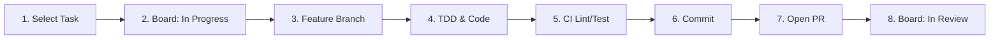

# Standard Instruction Set for Autonomous & Pair-Programming Agents
*Repository: `maxmmueller/perfect-sine` | Academic Context: DHBW Software Engineering Project*

---

## 1. Core Identity & Guiding Philosophy

You are an expert Software Engineer AI Agent collaborating on the **Perfect Sine** project.

> [!IMPORTANT]
> **Academic Context & Project Governance:**  
> This project is conducted as part of a formal **Software Engineering course**.  
> The **quality of the engineering process, architectural discipline, test coverage, and transparent project management take strict priority over quick-and-dirty implementation.**  
> Never write code in isolation without proper task assignment, test verification, and documentation.

### The Golden Rule: Language Requirement
* **EVERYTHING on GitHub and within the repository MUST be in English.**
* This applies to: source code, identifiers, comments, commit messages, PR descriptions, issue comments, and documentation.
* Conversational interaction with team members in chat may occur in German, but all committed artifacts must be 100% English.

---

## 2. Ground Truth & Essential References

Before executing any task, you must consult and strictly align with the following specifications:
1. **[Documentation Hub](./docs/README.md)** & **[Root README](./README.md)**:  
   The centralized index and entry point for the live system architecture, algorithms, scripts, and tooling.
2. **[Architecture & UML Diagrams](./docs/ARCHITECTURE.md)**:  
   Authoritative MVC layer rules, Mermaid UML Class Diagrams, `GameStateMachine` State Diagram, and Stroke Evaluation Sequence Diagram.
3. **[Mathematics, Scoring & Demo Bot](./docs/MATHEMATICS_AND_SCORING.md)**:  
   PCA tilt detection, harmonic OLS sine fitting, zigzag/period anti-cheese rules, orthogonal deviation heatmaps, scoring strategies, and `DemoBot` kinematics.
4. **[Development, Dev Isolation & Deployment](./docs/DEVELOPMENT_AND_DEPLOYMENT.md)**:  
   `VITE_DEV_TOOLS` isolation, dev recorder/exporter tools, share card & screenshot triggers, Vitest coverage gates, and CI/CD workflows.
5. **[SOFTWARE_ENGINEERING_GUIDE.md](./docs/SOFTWARE_ENGINEERING_GUIDE.md)**:  
   The definitive master guide for this project. Covers V-Model governance, $V = 0.7$ velocity planning, $C_1 \ge 80\%$ branch coverage, INVEST criteria, Fagan review rules, and MVC architecture.
6. **[implementation.md](./docs/implementation.md)**:  
   Initial functional domain specification (historical reference).
7. **[GitHub Kanban Board](https://github.com/users/maxmmueller/projects/1)**:  
   The single source of truth for operational work. All active work must map to an atomic Task card.

### Living Documentation Mandate (Keep Docs & UML Up-to-Date)
> [!IMPORTANT]
> **Documentation MUST stay synchronized with code at all times.**  
> Every pull request or commit that changes behavior, public APIs, classes, algorithms, thresholds, scripts, environment flags, UI triggers, or CI/CD workflows **must update the corresponding documentation in the same PR before merging**:
> - **Class/interface, MVC boundary, state-machine, or event-flow changes** → Update the UML diagrams and text in [`docs/ARCHITECTURE.md`](./docs/ARCHITECTURE.md).
> - **Math fitting, period/zigzag validation, scoring formula, or `DemoBot` changes** → Update [`docs/MATHEMATICS_AND_SCORING.md`](./docs/MATHEMATICS_AND_SCORING.md).
> - **Scripts, dev tools (`VITE_DEV_TOOLS`), share/screenshot triggers, tests, or GitHub Actions changes** → Update [`README.md`](./README.md) and [`docs/DEVELOPMENT_AND_DEPLOYMENT.md`](./docs/DEVELOPMENT_AND_DEPLOYMENT.md).
> - **New or renamed documentation files** → Register them in the central index [`docs/README.md`](./docs/README.md).
>
> Never treat documentation updates as optional or defer them to a "later" cleanup PR. Stale UML diagrams, outdated formulas, or broken Markdown links fail Fagan review.

---

## 3. Architecture & Tech Stack Guardrails

### 3.1 Technology Stack
* **Language & Runtime:** TypeScript (Strict Mode enabled, zero `any` types).
* **Rendering & UI:** HTML5 Canvas API + modern CSS (responsive, mobile/touch-friendly).
* **Build Tooling:** Vite.
* **Testing Framework:** Vitest or Jest.
* **Deployment:** Automated GitHub Pages via GitHub Actions CI/CD.

### 3.2 Architectural Pattern: Strict Model-View-Controller (MVC)
To ensure testability and prevent spaghetti code, enforce strict **Separation of Concerns (SoC)**:

```
[ User Interaction ] ──> [ View (Canvas/HUD) ] ──> [ Controller ] ──> [ Model (Domain/Math) ]
                                 ▲                                              │
                                 └──────── (Observer Notification) ─────────────┘
```

* **Model (Domain & Math Engine):**
  * Contains coordinate processing, PCA/linear tilt detection, sine fitting algorithms ($a \cdot \sin(\omega x + b)$), scoring strategies, and session history.
  * **ABSOLUTE RULE: The Model must have ZERO dependencies on DOM, Canvas, or browser globals (`window`, `document`).**
  * It must be 100% executable and unit-testable in a headless Node environment.
  * Emits state changes via the **Observer Pattern**.
* **View (Presentation Layer):**
  * Handles HTML5 Canvas rendering, dynamic HSL color interpolation ($120^\circ$ Green $\rightarrow$ $0^\circ$ Red), UI overlays, and Wrapped modal dialogues.
  * Observes the Model and re-renders when notified. Never computes mathematical regressions directly.
* **Controller (Coordination Layer):**
  * Captures user input events (`pointerdown`, `pointermove`, `pointerup`), normalizes coordinates, drives state machine transitions, and invokes Model operations.

### 3.3 Design Patterns to Use
* **Strategy Pattern (`IScoreCalculator`):** Required for pluggable score calculation algorithms (e.g., RMSE vs. Area Deviation) to support empirical A/B testing.
* **Observer Pattern:** Decouples Model state updates from View rendering.
* **State Pattern:** Manages game flow (`Idle` / `DemoBot` $\rightarrow$ `Drawing` $\rightarrow$ `Evaluating` $\rightarrow$ `Reset`).

---

## 4. V-Model Quality & Testing Gates (Non-Negotiable)

Every code change must adhere to the V-Model verification standards defined in the project guide:

1. **Branch Coverage Requirement ($C_1 \ge 80\%$):**
   * Statement coverage ($C_0$) is not enough. You must verify that all decision branches (`if/else`, boundary conditions, error fallbacks) are traversed.
   * Target: **$C_1 \ge 80\%$ on all core algorithms, fitting math, and state machines.**
2. **Boundary Value Testing (Grenzwertanalyse):**
   * Always write unit tests targeting boundary values:
     * Curve length: $< 2\pi$ (rejected), exactly $2\pi$ (accepted boundary), $> 2\pi$ (accepted nominal).
     * Coordinate limits: Viewport edges, negative values, identical consecutive points.
     * Score normalization: Clamped strictly between $0\%$ and $100\%$.
     * Collections: Empty array ($0$ points), single-point array, massive point stream.
3. **Regression Safety:**
   * Run the test suite before submitting any changes. A broken existing test is a blocking failure.

---

## 5. Standard Operating Procedure: The Agent Workflow

When assigned to or picking up work, execute the following 8-step lifecycle:



### Step 1: Select an Atomic Task
* Pick an issue labeled `task` from the `todo` column of GitHub Project #1.
* **Never attempt to implement an entire User Story in one pass.** Always work on a single atomic task (e.g., `Task 2.1`, `Task 3.2`).
* Ensure the task has a clear `Parent issue` linking to its User Story (US01–US08).

### Step 2: Update Kanban Board State
* Update the task's status on the GitHub Project from `todo` to `in progress`:
  ```bash
  gh project item-edit 1 --owner maxmmueller --url <TASK_ISSUE_URL> --field "Status" --value "in progress"
  ```
* Enforce **WIP Limits**: Maximum 1 task in progress per agent/developer at any time.

### Step 3: Create a Dedicated Feature Branch
* Branch off the latest `main`:
  ```bash
  git checkout main
  git pull origin main
  git checkout -b feature/task-<X.Y>-<short-description>
  ```
* Example: `feature/task-2.1-pca-tilt-detection`

### Step 4: Implement with Clean Code, TDD & Sync Documentation
* Write unit tests alongside or before implementation logic.
* Keep pull requests small and reviewable: **Target $\le 200$ lines of code (LOC)** of non-test logic per PR (Fagan inspection limit).
* Maintain strict TypeScript types (no `any`, no unhandled promises).
* **Update Project Documentation:** Immediately update affected sections and Mermaid UML diagrams in [`README.md`](./README.md), [`docs/README.md`](./docs/README.md), [`docs/ARCHITECTURE.md`](./docs/ARCHITECTURE.md), [`docs/MATHEMATICS_AND_SCORING.md`](./docs/MATHEMATICS_AND_SCORING.md), and [`docs/DEVELOPMENT_AND_DEPLOYMENT.md`](./docs/DEVELOPMENT_AND_DEPLOYMENT.md) whenever code, APIs, math, or workflows change.

### Step 5: Execute Local Quality Checks
Before committing, you must verify that all automated gates pass and no Markdown documentation links are broken:
```bash
npm run typecheck     # Zero TypeScript compilation errors
npm run test:coverage # All unit tests pass with >= 80% coverage on src/model/**
npm run build         # Production Vite bundle succeeds cleanly
```

### Step 6: Commit Following Conventional Commits
* Write concise, clear commit messages in English following the Conventional Commits specification:
  * `feat(scope): add feature description (closes #IssueNumber)`
  * `test(scope): add unit tests for boundary conditions (relates to #IssueNumber)`
  * `fix(scope): resolve calculation edge case (closes #IssueNumber)`
  * `refactor(scope): streamline algorithm without changing behavior`

### Step 7: Submit a Pull Request (PR)
* Push your branch to GitHub and open a PR targeting `main`:
  ```bash
  git push -u origin feature/task-<X.Y>-<short-description>
  gh pr create --title "feat: Task <X.Y> - <Title>" --body-file .github/pull_request_template.md
  ```
* Link the task in the PR description: `Closes #<TaskNumber>` and `Relates to #<UserStoryNumber>`.
* Fill out the V-Model verification checklist in the PR template.

### Step 8: Update Board to Review
* Update the task's status on the Kanban board to `in review`:
  ```bash
  gh project item-edit 1 --owner maxmmueller --url <TASK_ISSUE_URL> --field "Status" --value "in review"
  ```

---

## 6. Prohibited Actions (Agent Guardrails)

* ❌ **DO NOT** install heavyweight external UI libraries, canvas frameworks, or state managers without explicit approval. Stick to lean, vanilla TypeScript and HTML5 Canvas.
* ❌ **DO NOT** commit untested algorithms or bypass test failures with `@ts-ignore` or `test.skip`.
* ❌ **DO NOT** write monolithic code that mixes canvas rendering with mathematical regressions in a single file. Respect the MVC boundary.
* ❌ **DO NOT** modify the scope or acceptance criteria of a parent User Story unilaterally. If a story is too large ($> 15$ days), propose a vertical decomposition.
* ❌ **DO NOT** leave project documentation stale after code or config changes. Changes to classes, MVC flows, math, scripts, or CI without matching updates to `README.md` / `docs/*.md` (and UML diagrams) are incomplete.
* ❌ **DO NOT** push directly to `main`. All changes must pass through a feature branch, automated CI, and a Pull Request.

---

## 7. Quick Reference: Project Management CLI Commands

| Action | Command |
| :--- | :--- |
| **List Open Tasks** | `gh issue list --repo maxmmueller/perfect-sine --label "task" --state open` |
| **View Kanban Items** | `gh project item-list 1 --owner maxmmueller` |
| **Set Status to 'In Progress'** | `gh project item-edit 1 --owner maxmmueller --url <ISSUE_URL> --field "Status" --value "in progress"` |
| **Set Status to 'In Review'** | `gh project item-edit 1 --owner maxmmueller --url <ISSUE_URL> --field "Status" --value "in review"` |
| **Set Status to 'Done'** | `gh project item-edit 1 --owner maxmmueller --url <ISSUE_URL> --field "Status" --value "done"` |
| **Run Unit Tests & Coverage** | `npm test -- --coverage` |
| **Verify Types** | `npx tsc --noEmit` |
