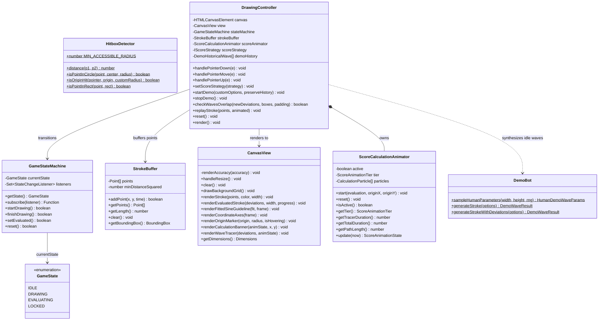
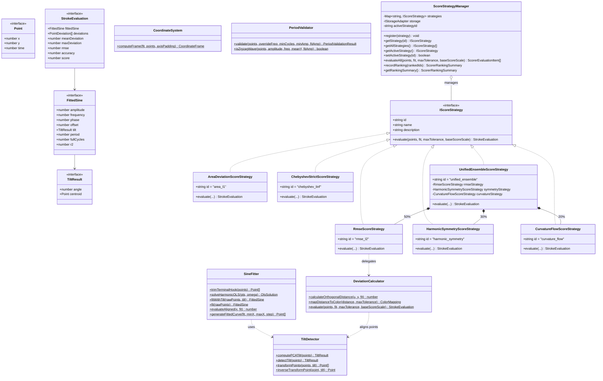
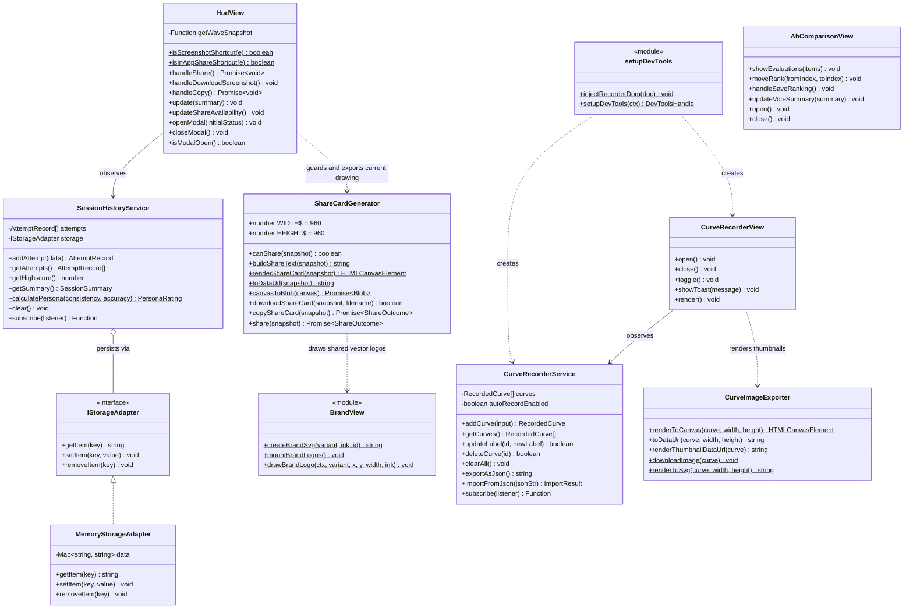
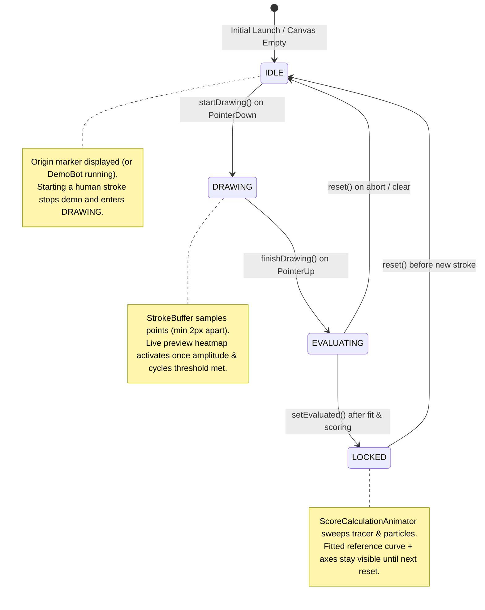
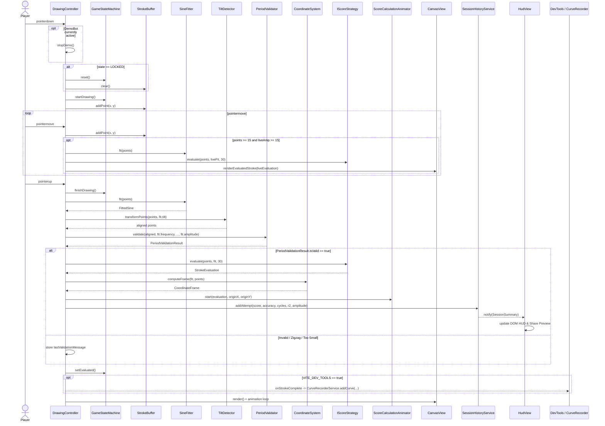

# Architecture & UML Diagrams

**Perfect Sine** follows a strict **Model-View-Controller (MVC)** architecture written in strict TypeScript (`strict: true`, `noImplicitAny: true`, `strictNullChecks: true`). The pure domain model has zero browser/DOM imports so every mathematical and stateful invariant is verifiable headlessly in Vitest.

---

## 1. Layer Boundaries & Runtime Bootstrap

The presentation uses one fixed dark palette (`ThemeView.getNotebookPalette()`)
for DOM styling, game canvas and share exports. There is no theme switch or
system/storage-driven theme initialization.

| Layer | Directory | Responsibilities | Forbidden Dependencies |
| :--- | :--- | :--- | :--- |
| **Model** | `src/model/`, `src/model/scoring/` | State machine, point sampling buffer, PCA tilt alignment, OLS sine fitting, period/zigzag validation, orthogonal distance, scoring strategies, demo trajectory synthesis, session & recorder persistence abstractions. | `window`, `document`, `HTMLCanvasElement`, CSS |
| **View** | `src/view/` | Retina-aware Canvas 2D rendering, live/evaluated heatmaps, fitted reference curves, axes, calculation particle/tracer animations, HUD/Share modal DOM updates, PNG Share Card generation, Dev UI drawers. | Mutating state machine directly; fitting math |
| **Controller** | `src/controller/` | Pointer event translation, origin hitbox detection, demo scheduling & overlap avoidance, continuous animation loops, orchestrating Model evaluation -> View rendering -> Session callbacks. | Embedding raw scoring equations |
| **Dev Isolation** | `src/dev/` | Dynamically imported dev-only wrapper (`setupDevTools.ts`) injecting Curve Recorder button/drawer DOM markup, `dev-tools.css`, and `window.__perfectSine` debug handle. | Bundled into `VITE_DEV_TOOLS=false` production builds |

### Bootstrap Flow (`src/main.ts`)

On `DOMContentLoaded`, [`initializeApp`](../src/main.ts) first mounts shared SVG
logos through `BrandView.mountBrandLogos()`, then wires:
1. `SessionHistoryService` (reading/writing `localStorage` via `IStorageAdapter` fallback)
2. `UnifiedEnsembleScoreStrategy` (`id = 'unified_ensemble'`)
3. `GameStateMachine`, `StrokeBuffer(2.0)`, and `CanvasView`
4. `DrawingController` with `onEvaluationComplete` -> `sessionService.addAttempt(...)`
5. `HudView` with a `getWaveSnapshot` callback restricted to a completed own
   drawing (`LOCKED`, demo stopped). State changes refresh share availability;
   the `LOCKED` update is deferred to a microtask so the captured stroke is ready.
   Session history cannot populate or enable sharing.
6. **Conditional Dev Tools:** Only when `import.meta.env.VITE_DEV_TOOLS === 'true'` does `main.ts` call `import('./dev/setupDevTools')`. Vite statically replaces `import.meta.env.VITE_DEV_TOOLS` during `vite build`, allowing Rollup to tree-shake all dev code and stylesheets from production artifacts.
7. Launches `controller.startDemo()` immediately and arms a 15-second idle timeout to resume the demo if the canvas remains empty after user interaction stops.

---

## 2. UML Class Diagrams

To preserve legibility, the full object model is organized into three cohesive UML class diagrams:
1. [Core MVC, Canvas & Demo Architecture](#21-core-mvc-canvas--demo-architecture)
2. [Mathematical Pipeline & Scoring Strategy Pattern](#22-mathematical-pipeline--scoring-strategy-pattern)
3. [Session Persistence, Sharing & Dev Tooling](#23-session-persistence-sharing--dev-tooling)

### 2.1 Core MVC, Canvas & Demo Architecture

### 2.2 Mathematical Pipeline & Scoring Strategy Pattern

### 2.3 Session Persistence, Sharing & Dev Tooling

---

## 3. UML State Machine Diagram (`GameStateMachine`)

`GameStateMachine` (`src/model/GameStateMachine.ts`) guarantees deterministic gameplay transitions and invalid-action guarding without any UI knowledge:

---

## 4. UML Sequence Diagram — End-to-End User Stroke Evaluation

