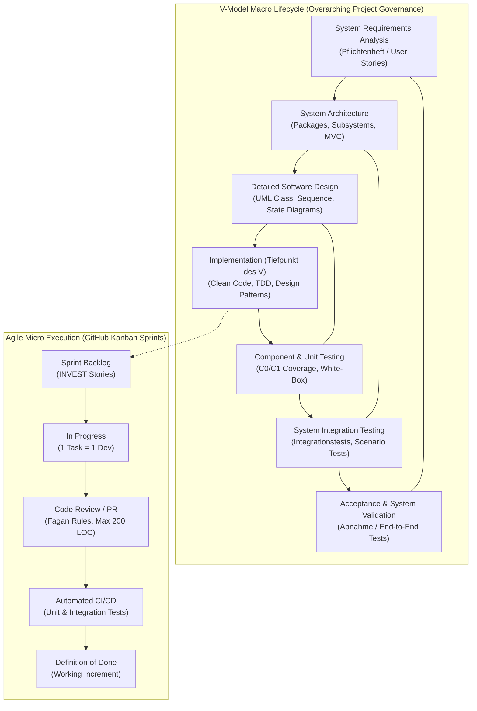
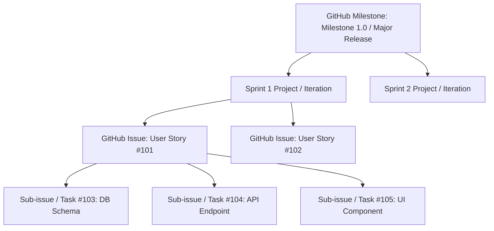
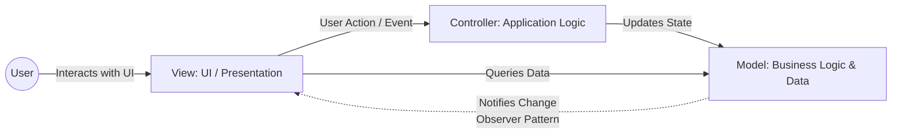
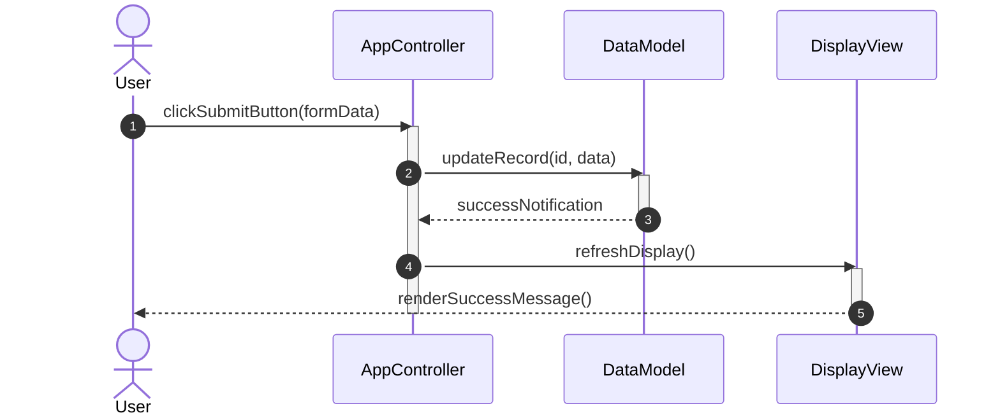

# Software Engineering Master Playbook & Project Management Guide
*A Unified Framework combining the V-Model, User Stories, and GitHub Kanban for University & Industry Projects*

---

## 1. Executive Overview & Hybrid Methodology

### 1.1 The Challenge: Why 80% of Software Projects Fail
Empirical software engineering data reveals that **nearly 80% of software projects fail or exceed their budget and timeline**. The primary drivers of failure are not low-level coding errors, but systemic organizational pitfalls:
1. **Unrealistic Planning & "Optimism Bias"**: Teams assume 100% productive time without calculating organizational overhead, context switches, or bugs.
2. **Ambiguous Requirements**: Conflating subjective *system goals* with objective, testable *requirements*.
3. **Big-Bang Integration**: Writing code for months and attempting to integrate and test at the very end.
4. **Poor Change Management**: Scope creep without reprioritizing existing commitments with stakeholders.

### 1.2 The Hybrid Solution: Macro Governance with Micro Agility
To overcome these failure modes, this project adopts a **Hybrid Software Process Model**:
* **Macro-Level Governance: The V-Model (V-Modell)**
  Provides the overarching lifecycle, architectural hierarchy, formal verification and validation (V&V), and systematic quality gates. It ensures that every architectural layer has an explicit, pre-defined testing level.
* **Micro-Level Execution: Agile Sprints, User Stories & GitHub Kanban**
  Provides day-to-day agility, rapid feedback loops, transparent issue tracking, vertical feature slicing, and continuous delivery within short timeboxes (**RDCT: Requirements, Design, Code, Test**).

```text
  +-----------------------------------------------------------------------------------------+
  |                   V-MODELL MAKRO-LIFECYCLE & QUALITÄTSSICHERUNG                         |
  +-----------------------------------------------------------------------------------------+
  Requirements Analysis (Bedarf)  <===============================>  System Validation (Abnahme)
         \                                                                   /
          \                                                                 /
     System Architecture (MVC)  <=============================>  System Integration Tests
             \                                                           /
              \                                                         /
         Detailed Software Design  <======================>  Unit / Component Tests (C0/C1)
                 \                                                     /
                  \                                                   /
               Implementation (Code)  -------------------->  [ Sprint Backlog (DoR) ]
               (Tiefpunkt des V)                                       |
                                                                       v
                                                             [ In Progress (1 Dev) ]
                                                                       |
                                                                       v
                                                             [ Peer Review (PR) ]
                                                                       |
                                                                       v
                                                             [ Definition of Done ]
```



### 1.3 Lehman's Laws of Software Evolution (1980)
Software systems are never static; they evolve continuously within an changing environment:
1. **Continuing Change**: A system deployed in the real world must continually adapt, or it becomes progressively less useful.
2. **Increasing Complexity**: As an evolving program is modified, its structure degrades and complexity increases unless active, conscious effort (refactoring) is devoted to maintenance.
3. **Self-Regulation**: Project dynamics (size, defect arrival rate, cycle time) exhibit statistically stable trends.
4. **Conservation of Organizational Stability**: The effective throughput of an organization over a project lifetime remains largely invariant regardless of resource influx.
5. **Conservation of Familiarity**: The incremental release content must remain bounded to maintain team and user familiarity.

> [!IMPORTANT]
> **Practical Takeaway from Lehman**:
> * Never attempt massive structural refactorings in a single release. Break changes into small, incremental releases.
> * Allocate dedicated buffer time solely for technical debt reduction and bug elimination without introducing new functional features.
> * Keep team sizes small to minimize geometric communication overhead ($Communication\,Channels = \frac{n(n-1)}{2}$).

---

## 2. The Macro Layer: V-Model Architecture & Quality Assurance

### 2.1 Evolution of the V-Model
* **Boehm (1979)**: Introduced the classic V-Model as an extension of the waterfall model, folding development upwards to link development stages directly with testing stages.
* **V-Modell 93 (Civil)**: Standardized for public administration to make total costs across development and maintenance transparent, enforce minimum software quality standards, and standardize in-house engineering.
* **V-Modell 97**: Integrated Object-Oriented Analysis and Design (OOA/OOD).
* **V-Modell XT (Extreme Tailoring, 2005)**: Shifted focus from rigid phase gates to project-specific adaptation (*Tailoring*). Centers around four core capabilities (*V-Kern*):
  1. Project Management (PM)
  2. Quality Assurance (QA)
  3. Configuration Management (CM)
  4. Problem and Change Management

### 2.2 The V-Model Levels & Their Verification/Validation Pairs
Every phase on the left descending arm is directly mirrored and verified by a corresponding phase on the right ascending arm:

| Left Arm (Specification & Design) | Deliverable / Artifact | Right Arm (Testing & Integration) | Verification & Validation Scope |
| :--- | :--- | :--- | :--- |
| **System Requirements Analysis** *(Bedarfsanalyse)* | Requirements Catalog *(Pflichtenheft)*, High-Level Epics, User Stories | **Acceptance & System Validation** *(Abnahme / Nutzung)* | **Validation**: Does the product satisfy actual user needs? Verified against customer acceptance criteria. |
| **System Architecture** *(Systemarchitektur)* | Subsystem architecture, Component boundaries, MVC structure | **System & Integration Testing** *(Systemintegration)* | Evaluates multi-component workflows, performance, system limits, and end-to-end data integrity. |
| **Detailed Software Design** *(Software-Entwurf)* | UML Class Diagrams, Sequence Diagrams, State Machines | **Integration & Interface Testing** *(Integrationstests)* | Verifies object interaction, message-passing paths, API contracts, and cluster communication. |
| **Component Design** *(Komponenten-Entwurf)* | Method signatures, algorithm design, data structures | **Unit / Component Testing** *(Komponententests)* | **Verification**: Verifies code against technical specifications using white-box testing ($C_0, C_1$). |
| **Implementation** *(Tiefpunkt des V)* | Source code, Clean code, automated build pipelines | **Code Inspection / Peer Review** | Peer reviews (Fagan inspection), static analysis, and automated linting. |

### 2.3 Verification, Validation & Reliability (V&V)
* **Verification ("Building the product right")**: Does the software conform strictly to its written specification? (Objective comparison against requirements).
* **Validation ("Building the right product")**: Does the software actually solve the user's problem and satisfy operational requirements? (Subjective satisfaction and operational usability).
* **Reliability Testing**: Does the software consistently perform without failures under specified operational profiles?
  * *Realistic definition of reliability*: The software must conform to spec, **never produce silently wrong output**, **never crash or terminate unexpectedly**, perform sensible and helpful fallback actions in unforeseen situations, and only fail gracefully when continuation is mathematically or physically impossible.

---

## 3. Requirements Engineering & User Stories in GitHub

### 3.1 Goals vs. Requirements
A frequent cause of project failure is confusing subjective aspirations with verifiable specifications:
* **System Goal (Ziel)**: An abstract, subjective direction. It cannot be objectively measured or validated via automated tests (e.g., *"The system must be intuitive and user-friendly"*).
* **Requirement (Anforderung)**: An objective, verifiable, testable property or constraint that limits the solution space (e.g., *"Any order must be confirmed via a modal dialogue within 2 clicks and processed under 500 ms"*).

### 3.2 Structure of the Requirements Specification (Yeh & Zave / Heninger)
A standard requirements catalog (*Software Requirement Document / Pflichtenheft*) must specify **WHAT** the system must do, never **HOW** it must be implemented. Heninger (1980) defines 6 essential properties:
1. Specify only external behavior.
2. Specify explicit operational constraints.
3. Be maintainable and easily modifiable.
4. Serve as an unambiguous reference for maintenance.
5. Anticipate future software lifecycle iterations.
6. Explicitly define expected behavior for unexpected and adverse events (exception handling).

### 3.3 Modern User Story Architecture
In modern agile and hybrid SE, functional requirements are expressed as **User Stories** (also called Functional Software Units or Modules).

#### The Standard Satzschablone (Template)
$$\text{Als [Rolle/Benutzer] möchte ich [Ziel/Aktion], um [Nutzen/Mehrwert] zu erzielen.}$$
* *Example*: *"As a registered customer, I want to filter flights by departure time, so that I can book a flight matching my personal schedule."*

#### The INVEST Quality Criteria (Bill Wake)
* **I - Independent**: Stories should be decoupled; completing one story should not be blocked by another in the same sprint.
* **N - Negotiable**: Stories are not rigid contracts. The team and PO refine details during refinement and planning.
* **V - Valuable**: Delivers recognizable, measurable value to end users or the business.
* **E - Estimable**: Sufficiently clear that developers can estimate effort with confidence.
* **S - Small**: Must easily fit within a single iteration/sprint. **Rule of thumb: Any story estimated at $>15$ work days is too large and MUST be decomposed!**
* **T - Testable**: Must contain concrete, objective acceptance criteria enabling automated or manual pass/fail verification.

#### The 3 C's Framework (Ron Jeffries)
1. **Card**: Physical or digital token representing the requirement with concise metadata.
2. **Conversation**: Ongoing verbal/written dialogue between Product Owner and Developers to clarify edge cases.
3. **Confirmation**: Acceptance Criteria (Definition of Done) that prove the story is complete.

### 3.4 Vertical Slicing: Decomposing Large User Stories
Never split user stories horizontally into technical layers (e.g., *"Sprint 1: Database"*, *"Sprint 2: Backend"*, *"Sprint 3: UI"*). This creates zero customer value until the final sprint and prevents early testing.
* **Vertical Slicing (Vertikales Schneiden)**: Every user story must cut through all relevant system layers (UI $\rightarrow$ Controller $\rightarrow$ Business Logic $\rightarrow$ Persistence) delivering a usable end-to-end slice.
* **Strategies to Decompose**:
  1. *By Workflow Step*: Slice a complex 5-step wizard into distinct standalone steps.
  2. *By Business Rule / Scenario*: Handle the happy path first, then edge cases in separate stories.
  3. *By Data Variation*: Start with simple text payload, add file attachments or multimedia in subsequent stories.

### 3.5 Tasks: Breaking Down Stories for Developers
A User Story is owned by the team, but it is broken down into concrete **Technical Tasks**:
* **Rule: Each Task is executed by EXACTLY ONE developer.**
* Tasks specify technical implementation details (e.g., *"Create PostgreSQL migration for appointment table"*, *"Implement JWT authentication middleware"*).
* **Bottom-Up Estimation Advantage**: Summing task-level estimates produces far more accurate predictions than top-down story guesses.

---

## 4. Estimation, Velocity & Milestone Planning

### 4.1 The 4-Step Estimation Consensus Workflow
1. **Requirements Study**: Read the story, acceptance criteria, and architecture models; ask the PO clarifying questions.
2. **Independent Estimation**: Every team member provides an independent estimate simultaneously (e.g., via Planning Poker) to prevent anchoring bias.
3. **Clarify Divergence & Assumptions**: If estimates diverge, the highest and lowest estimators explain their rationale. If fundamental uncertainties exist, return to step 1.
4. **Reach Consensus**: Re-estimate until estimates cluster tightly. Use the spread to document Best-Case and Worst-Case bounds.

### 4.2 Planning Poker & The Fibonacci Scale
Agile estimation uses modified Fibonacci numbers: `0, 1, 2, 3, 5, 8, 13, 20, 40, 100`.
* **Points represent relative complexity and uncertainty, not raw hours.**

| Value | Complexity | Practical Interpretation |
| :---: | :--- | :--- |
| **0** | Done | Trivial fix, already done or zero effort. |
| **1** | Very Low | Trivial task; routine, zero unknowns (e.g., update a config parameter). |
| **2** | Low | Simple task; well-understood pattern. |
| **3** | Moderate | Standard task; standard component creation. |
| **5** | Medium | Significant logic involved, multiple classes touched. |
| **8** | High | Complex logic, external dependencies, high testing effort. |
| **13** | Very High | Upper limit for a single story. Approaches the 15-day limit; consider splitting. |
| **20 / 40** | Huge / Unschätzbar | Epic level. Cannot be planned into a sprint without decomposition. |
| **100** | Infinite / Unfathomable | Requirements fundamentally unclear; spike or prototyping required. |

### 4.3 The Velocity Factor ($V$-Faktor) Formula
A fundamental mistake in software planning is assuming that an 8-hour workday equals 8 hours of productive coding. In reality, teams experience friction: meetings, setup, tooling issues, sickness, code reviews, and administrative duties.
* **Initial Velocity Factor for New Teams**: Set $V = 0.7$ (70% productive capacity).

$$\text{Available Capacity (Productive Days)} = \text{Developers} \times \text{Workdays per Sprint} \times V$$

$$\text{Real Project Duration} = \frac{\text{Estimated Work Days}}{V}$$

#### Worked Example:
* **Team**: 3 developers
* **Sprint Length**: 20 workdays (4 calendar weeks)
* **Velocity ($V$)**: $0.7$
* **Available Productive Capacity per Sprint**:
  $$3 \times 20 \times 0.7 = 42\text{ productive developer days}$$
* If the backlog for Milestone 1.0 contains 126 estimated days of user stories:
  $$\text{Required Sprints} = \frac{126\text{ days}}{42\text{ days/sprint}} = 3\text{ Sprints (approx. 12 calendar weeks)}$$
* If an unplanned story with an estimate of 20 days is added:
  $$\text{Real Delay} = \frac{20}{0.7} = 28.6\text{ real calendar/work days!}$$

### 4.4 Managing Overruns: The 4 Strategic Options
When velocity tracking reveals that commitments exceed capacity, never hide the delay. Present the stakeholder with 4 structured alternatives:
1. **Adjust Timeline**: Add an additional iteration to the milestone, shifting release date outward.
2. **Add Resources**: Onboard an additional developer (caution: Brooks' Law dictates that adding manpower to a late software project makes it later in the short term!).
3. **Reprioritize (Scope Reduction)**: Move lower-priority stories ($Priority = 40, 50$) out of the current milestone into the next release.
4. **Transparent Communication**: Review the data-backed velocity and burndown chart with the stakeholder to renegotiate scope collaboratively.

---

## 5. Operational Execution: GitHub Projects & Kanban

### 5.1 Hierarchical Structure in GitHub
Map the SE hierarchy directly into GitHub native artifacts:



### 5.2 GitHub Kanban Board Columns & WIP Limits
To avoid context-switching bottlenecks and enforce continuous flow, configure the GitHub Projects Board with strict **Work In Progress (WIP) Limits**:

```
[ Product Backlog ] ──> [ Sprint Backlog (DoR) ] ──> [ In Progress (WIP: max 3) ] ──> [ Review / PR (WIP: max 2) ] ──> [ Verification / QA ] ──> [ Done (DoD) ]
```

1. **Product Backlog**: Prioritized repository of all open User Stories (owned by PO).
2. **Sprint Backlog / Ready**: Stories meeting the **Definition of Ready (DoR)** selected for the current iteration.
3. **In Progress (WIP Limit = 1 per developer)**: Active coding. Exactly one task per developer at any time.
4. **Review / PR (WIP Limit = 2)**: Pull Requests undergoing peer inspection.
5. **Verification / QA**: Integrated into main/staging branch, undergoing automated tests and scenario verification.
6. **Done**: Meets the full **Definition of Done (DoD)**.

### 5.3 Quality Gates: Definition of Ready (DoR) vs. Definition of Done (DoD)

#### Definition of Ready (DoR) Checklist (Story Entry Criteria)
Before a User Story can be pulled into a Sprint:
* [ ] Conforms to the standard template (*"As a... I want... So that..."*).
* [ ] Meets the INVEST criteria.
* [ ] Estimated effort is $\le 15$ work days (or $\le 8$ Story Points).
* [ ] Clear, testable Acceptance Criteria defined (Confirmation).
* [ ] External architectural and technical dependencies identified and resolved.
* [ ] Visual mockups or UI wireframes attached (if user-facing).

#### Definition of Done (DoD) Checklist (Story Exit Criteria)
Before a User Story can be moved to `Done`:
* [ ] Code adheres to team coding standards and clean code conventions.
* [ ] Unit tests implemented and passing with required branch coverage ($C_1 \ge 80\%$).
* [ ] Integration / Scenario tests implemented and passing.
* [ ] Peer code review approved by at least 1 other team member (following Fagan rules).
* [ ] Static code analysis (linter) passes with zero errors/warnings.
* [ ] Documentation updated (README, API docs, code comments where necessary).
* [ ] PR merged into target branch via CI pipeline without breaking main.
* [ ] Acceptance criteria verified and accepted by Product Owner.

### 5.4 Sprint Ceremonies & Rhythm
* **Sprint Planning (Max 4h for 2-week sprint)**: PO presents highest-priority backlog items; team breaks them into tasks, estimates, and defines the **Sprint Goal**.
* **Daily Scrum (Strictly 15 Minutes)**: Daily synchronisation in front of the Kanban board.
  * *What did I do yesterday?*
  * *What will I do today?*
  * *What impediments/blockers are in my way?*
  * *Note: Absolutely NO problem-solving in the daily! Schedule follow-up breakout sessions for technical debates.*
* **Sprint Review (1-2h)**: Live demonstration of working software increment to stakeholders. Solicit feedback.
* **Sprint Retrospective (1h)**: Team internal review focused on the *process*:
  * **Keep (Was lief gut?)**
  * **Drop (Was müssen wir abstellen?)**
  * **Start (Was wollen wir neu ausprobieren?)**

---

## 6. Architecture & Software Design Patterns

### 6.1 Architectural Pattern: Model-View-Controller (MVC)
The MVC pattern enforces strict **Separation of Concerns (SoC)** by decoupling domain logic from user interface presentation.



* **Model (M)**:
  * Contains core domain data, business logic, persistence interfaces, and integrity rules.
  * **Must remain completely independent of View and Controller**. It knows nothing of HTML, buttons, or display logic.
  * Broadcasts state change events to registered listeners via the **Observer Pattern**.
* **View (V)**:
  * Renders data from the Model to the screen.
  * Captures user input events and immediately delegates them to the Controller.
  * Observes the Model to re-render upon state changes.
* **Controller (C)**:
  * Acts as the coordinator. Translates user gestures into business actions.
  * Validates input parameters, invokes appropriate Model methods, and selects/configures the appropriate View.

### 6.2 Gang of Four (GoF) Design Patterns Catalog
Design patterns are reusable, battle-tested solutions to recurring software architecture challenges.

#### 1. Creational Patterns (Erzeugungsmuster)
* **Factory Method**: Defines an interface for creating an object, but lets subclasses decide which class to instantiate. Decouples client code from concrete classes.
* **Abstract Factory**: Creates families of related or dependent objects without specifying their concrete classes.
* **Singleton**: Ensures a class has only one instance and provides a global point of access.
  > [!CAUTION]
  > Use Singleton with extreme care! Singletons introduce global state, tightly couple components, and make isolated unit testing difficult. Prefer Dependency Injection where possible.
* **Builder**: Separates the construction of a complex object from its representation, allowing the same construction process to create various representations step-by-step.
* **Prototype**: Creates new objects by cloning an existing configured instance, bypassing expensive initialization.

#### 2. Structural Patterns (Strukturmuster)
* **Adapter (Wrapper)**: Converts the interface of an existing class into another interface clients expect, enabling incompatible classes to cooperate.
* **Decorator**: Attaches additional responsibilities and behavior to an object dynamically and transparently without subclassing.
* **Facade**: Provides a unified, simplified, high-level interface to a complex subsystem or collection of classes.
* **Composite (Kompositum)**: Composes objects into tree structures to represent part-whole hierarchies. Enables clients to treat individual objects and object compositions uniformly.
* **Proxy**: Provides a surrogate or placeholder for another object to control access to it (e.g., lazy loading, security check, remote RPC).

#### 3. Behavioral Patterns (Verhaltensmuster)
* **Observer (Beobachter / Publish-Subscribe)**: Defines a one-to-many dependency between objects so that when one object changes state, all registered dependents are automatically notified and updated.
* **Strategy**: Defines a family of algorithms, encapsulates each one into a separate class, and makes them interchangeable at runtime.
* **Command**: Encapsulates a request as a standalone object, enabling parameterization of clients, action queuing, execution logging, and undo/redo operations.
* **State (Zustand)**: Allows an object to alter its behavior when its internal state changes, appearing to change its class.
* **Template Method (Schablonenmethode)**: Defines the skeleton of an algorithm in an abstract base class, deferring specific implementation steps to subclasses without altering the overall algorithm structure.

---

## 7. System Modeling with UML 2.0

### 7.1 Unified Modeling Language (UML) Overview
UML 2.0 provides standard visual notations for Object-Oriented Analysis (OOA) and Object-Oriented Design (OOD).
* **Structural Diagrams**: Class Diagram, Object Diagram, Package Diagram, Component Diagram, Deployment Diagram.
* **Behavioral Diagrams**: Sequence Diagram, State Machine Diagram, Use Case Diagram, Activity Diagram.

### 7.2 Class Diagrams (Klassendiagramme)
* **Member Visibility**:
  * `+` Public (accessible everywhere)
  * `-` Private (accessible only within defining class)
  * `#` Protected (accessible within class and derived subclasses)
  * `~` Package / Internal (accessible within same package/namespace)
* **Relationships**:
  * **Association**: General structural link between classes ($A \rightarrow B$). May include multiplicities (`0..1`, `1`, `*`, `1..*`).
  * **Aggregation ($\diamondsuit$)**: Open diamond. Weak "has-a" relationship; parts can exist independently of the whole (e.g., *Department $\diamondsuit$ Employee*).
  * **Composition ($\blacklozenge$)**: Solid diamond. Strong "consists-of" relationship; lifecycle of parts is bound to the whole (e.g., *House $\blacklozenge$ Room*).
  * **Generalization ($\triangle$)**: Hollow triangle arrow. Inheritance / "is-a" relationship ($SubClass \rightarrow SuperClass$).
  * **Realization ($\dashrightarrow\triangle$)**: Dashed line with hollow triangle. Interface implementation ($Class \dashrightarrow Interface$).
  * **Dependency ($\dashrightarrow$)**: Dashed arrow. Class uses another class temporarily (e.g., method parameter).

### 7.3 Sequence Diagrams (Sequenzdiagramme)
Model the dynamic, time-ordered exchange of messages between lifelines (time flows downward).



#### Message Syntax & Symbols:
* **Synchronous Call**: Solid line with solid filled arrowhead (`->`). Caller blocks until execution finishes.
* **Asynchronous Signal**: Solid line with open arrowhead (`->`). Caller triggers message and continues immediately without blocking.
* **Reply / Return Message**: Dashed line with open arrowhead (`-->`). Returns control and optional return values.
* **Creation Message**: Dashed line with open arrow pointing directly to the participant box header (`<<create>>`).
* **Destruction Message**: Solid line ending at a large `X` on the lifeline, denoting instance destruction.
* **Found Message**: Originates from a filled black circle (incoming message from outside system boundaries).
* **Lost Message**: Terminates at a filled black circle (message departing known scope).

#### Combined Fragments (Kombinierte Fragmente):
* `alt`: Alternative execution paths (if-then-else). Mutually exclusive guards `[condition]`.
* `opt`: Optional branch (if-then without else).
* `loop`: Repetitive execution with loop bound `[min, max]` or guard condition.
* `par`: Parallel execution across concurrent lifelines/threads.
* `break`: Exception break-out; executes if condition is met, abandoning remainder of enclosing interaction.
* `ref`: Reference to an external, independently documented sequence diagram.

### 7.4 State Machine Diagrams (Zustandsdiagramme)
Based on David Harel's Statecharts. Models dynamic behavior of an entity transitioning between a finite set of states in response to events.
* **Core Axioms**: An entity is in exactly one active state at any given moment (or one state per orthogonal region). All states must be reachable from the initial state.
* **Transition Syntax**:
  $$\text{Trigger [Guard] / Action}$$
  * **Trigger**: Event initiating the state transition.
  * **Guard**: Boolean expression evaluated when event occurs. Transition fires only if guard is `true`.
  * **Action**: Atomic, non-interruptible operation executed during the transition.
* **Internal State Activities**:
  * `entry / action`: Executed immediately when entering the state.
  * `exit / action`: Executed immediately before departing the state.
  * `do / activity`: Continuous, interruptible work performed while remaining in the state.
* **Advanced Constructs**:
  * **Composite States**: Hierarchical nesting containing substates.
  * **Orthogonal Regions**: Parallel substates running concurrently, separated by dashed lines.
  * **History States**: Shallow History (`H`) restores the most recent active direct substate; Deep History (`H*`) restores the most recent active leaf substate.

---

## 8. Testing Strategy & Quality Assurance

### 8.1 Testing Axioms & Principles
* *"Testing shows the presence, not the absence of bugs!"* (Edsger W. Dijkstra).
* Exhaustive testing of all possible input combinations and paths is mathematically impossible. Therefore, testing must rely on **systematic subset selection**.
* The selection of test cases must be designed by Software Engineers based on structural and functional criteria, never left to ad-hoc developer testing.

### 8.2 Black-Box Testing (Functional / Specification-Based)
Black-box testing derives test cases strictly from specifications and interface contracts without examining internal source code.

#### 1. Equivalence Partitioning (Äquivalenzklassenbildung)
Divide the complete input and output domain into disjoint subsets (*equivalence classes*) where the program is assumed to handle all members identically:
* **Valid Equivalence Classes (Gültige Äquivalenzklassen)**: Realistic, valid inputs that should succeed.
* **Invalid Equivalence Classes (Ungültige Äquivalenzklassen)**: Illegal, boundary-violating, or erroneous inputs that must trigger proper error handling.
* **Rule**: Select at least one representative test value from each defined equivalence class.

#### 2. Boundary Value Analysis (Grenzwertanalyse)
Experience shows that defects cluster predominantly around the boundaries of equivalence classes. For any range $[Min, Max]$:
* Test values: $Min - 1$ (invalid), $Min$ (boundary), $Min + 1$ (valid), $Nominal$ (typical), $Max - 1$ (valid), $Max$ (boundary), $Max + 1$ (invalid).
* For arrays/sequences: Test empty collection ($0$ elements), single-element collection ($1$ element), first element, middle element, last element, and maximum capacity.

### 8.3 White-Box / Structural Testing (Kontrollflussorientiert)
White-box testing uses source code inspection and control-flow graphs (CFG) to measure execution coverage:

```
Nodes (Anweisungen) ──> Edges (Zweige) ──> Paths (Pfade)
      [C0]                      [C1]                 [C2]
```

1. **Statement Coverage ($C_0$, Anweisungsüberdeckung)**:
   * Percentage of executable statements executed at least once.
   * **Weakest measure**. Can achieve 100% $C_0$ while completely missing empty `else` branches or unhandled condition outcomes.
2. **Branch Coverage ($C_1$, Zweigüberdeckung)**:
   * Percentage of decision branches (e.g., both `true` and `false` evaluations of each conditional branch) traversed.
   * **The professional industry standard minimum requirement for unit tests.**
   * Formula:
     $$C_1 = \frac{\text{Traversed Decision Branches}}{\text{Total Decision Branches}} \times 100\% \ge 80\%$$
3. **Path Coverage ($C_2$, Pfadüberdeckung)**:
   * Percentage of all theoretically possible execution paths traversed from entry to exit.
   * In programs containing loops, the number of paths is often infinite, making full $C_2$ impossible. Modified variants like Basis Path Testing are used instead.

### 8.4 Integration Strategies & Object-Oriented Testing
* **Top-Down Integration**: Starts with high-level coordination modules. Early validation of architecture, but requires **Stubs** (dummy lower-level implementations).
* **Bottom-Up Integration**: Starts with foundational classes/utilities. Easy to construct unit tests, but requires **Test Drivers (Testtreiber)** to invoke components and delays overall system-level validation.
* **Object-Oriented Integration Clusters**:
  * Classes collaborate in functional clusters.
  * **Scenario-Based Testing**: Derived from User Stories and Use Cases. Tests high-probability scenarios first, followed by edge-case and recovery scenarios.
  * **Method-Message Paths (ASF - Atomic System Functions)**: Tracing the cascade of messages triggered by an external event until state stabilizes.
* **Regression Testing**: Automated re-execution of all existing test suites upon every code change to guarantee that bugfixes or new features do not break previously working functionality.

### 8.5 Code Inspection & Peer Reviews (Fagan Inspection Rules)
Formal code reviews are among the most cost-effective validation techniques available, catching bugs before they reach automated test stages.

> [!IMPORTANT]
> **Fagan Review Rules for Pull Requests**:
> 1. **Advance Distribution**: Materials must be distributed to reviewers in advance. Reviewing raw code on the spot during a meeting is wasted time.
> 2. **Team Size**: Optimal size is **3 to 7 participants** (sweet spot: 4 participants: Moderator, Author, Designer/Architect, Tester).
> 3. **Timebox**: Maximum **2 hours per session**. Human cognitive focus and defect-detection efficiency drop steeply after 90–120 minutes.
> 4. **Scope Limit**: Review a maximum of **150 to 200 lines of code (LOC)** (excluding comments) or ~25 pages of documentation per session.
> 5. **Find Bugs, Don't Fix Them**: The review session exists solely to **identify and log defects**, NOT to redesign or re-code solutions in the meeting.
> 6. **Constructive Tone**: Critique the **product**, never the programmer. Review logs must never be used for personal performance evaluation.
> 7. **Mandatory Feedback**: Every reviewer must state at least one positive aspect and one critical defect/question.
> 8. **No Style Wars**: Coding style and formatting disputes belong in automated linters (`prettier`, `eslint`, `black`), not human review meetings!

---

## 9. Usability Engineering & UX Principles

### 9.1 Usability vs. User Experience (UX)
* **Usability (ISO 9241-11)**: The pragmatic degree of effectiveness, efficiency, and satisfaction with which specified users achieve specified goals in a specified context of use.
* **User Experience (UX)**: A holistic perspective encompassing user perceptions, emotional responses, aesthetics, brand perception, and subjective pleasure before, during, and after product interaction.

### 9.2 Jakob Nielsen's 10 Usability Heuristics
Apply these 10 core heuristics when designing and reviewing frontend User Stories:
1. **Visibility of System Status**: Always keep users informed about what is happening through timely, appropriate feedback (spinners, progress bars, success toasts).
2. **Match Between System and the Real World**: Speak the user's language using familiar words, phrases, and concepts rather than system-oriented jargon.
3. **User Control and Freedom**: Provide clear "emergency exits" (undo, redo, cancel, back buttons) when users make mistaken selections.
4. **Consistency and Standards**: Adhere to established UI conventions and terminology across all pages and dialogs.
5. **Error Prevention**: Better than good error messages is careful design that prevents errors from occurring (disabled invalid states, confirmation prompts for destructive actions).
6. **Recognition Rather than Recall**: Minimize user memory load by making objects, actions, and options visible; don't force users to remember information across screens.
7. **Flexibility and Efficiency of Use**: Provide accelerators and keyboard shortcuts for expert users while keeping basic flows simple for novices.
8. **Aesthetic and Minimalist Design**: Dialogues should not contain irrelevant or rarely needed information; every extra element competes with relevant information.
9. **Help Users Recognize, Diagnose, and Recover from Errors**: Error messages must be expressed in clear, plain language (no raw stack traces), precisely pinpoint the problem, and suggest a constructive solution.
10. **Help and Documentation**: Provide easily searchable, concise, task-focused assistance when necessary.

---

## 10. Operational Templates for GitHub

### 10.1 GitHub Issue: User Story Template
Save in `.github/ISSUE_TEMPLATE/user_story.md`:

```markdown
---
name: "User Story"
about: "Feature specification based on INVEST criteria"
title: "US: [Short Descriptive Feature Title]"
labels: ["user-story", "needs-refinement"]
assignees: ""
---

### 1. User Story Statement
**As a** [specific user role/persona],  
**I want to** [action/capability],  
**So that** [achievable business value/benefit].

---

### 2. Context & Preconditions
* **Preconditions**:
* **Target Milestone**: Milestone 1.0
* **Priority**: [10 = Critical / 20 = High / 30 = Medium / 40 = Low / 50 = Nice-to-have]
* **Story Points / Estimate**: [Fibonacci: 1, 2, 3, 5, 8, 13] (Must be <= 13 points / <= 15 days)

---

### 3. Acceptance Criteria (Confirmation)
- [ ] **Given** [initial state], **When** [action executed], **Then** [expected result].
- [ ] **Given** [invalid input], **When** [action submitted], **Then** [friendly error displayed without crash].
- [ ] Responsive UI verified across viewports.

---

### 4. Technical Tasks Breakdown
*Every task must be assigned to exactly ONE developer.*
- [ ] Task 1: [Database / Entity definition] - Assignee: @username (Estimate: X h)
- [ ] Task 2: [Backend Service / API endpoint] - Assignee: @username (Estimate: Y h)
- [ ] Task 3: [Frontend View / Component integration] - Assignee: @username (Estimate: Z h)
- [ ] Task 4: [Unit & Integration Tests] - Assignee: @username (Estimate: W h)
```

### 10.2 GitHub Issue: Technical Task Template
Save in `.github/ISSUE_TEMPLATE/technical_task.md`:

```markdown
---
name: "Technical Task"
about: "Single-developer work package derived from a User Story"
title: "Task: [Concrete Technical Action]"
labels: ["task"]
assignees: ""
---

### Parent Story
Refers to User Story: # [Issue Number]

### Technical Scope
* **Assignee**: (Exactly ONE developer)
* **Estimated Effort**: [Hours / Days]
* **Target Branch**: `feature/[story-id]-[short-name]`

### Implementation Steps
- [ ] Write unit tests for happy and edge-case paths.
- [ ] Implement class / service logic adhering to design pattern.
- [ ] Verify branch coverage ($C_1 \ge 80\%$).
- [ ] Format code with team linter.
```

### 10.3 GitHub Pull Request (PR) Template
Save in `.github/pull_request_template.md`:

```markdown
## Description
Resolves #[Issue Number]

### Changes Summary
- Summary of technical changes implemented.
- Design patterns or architectural modifications introduced.

### V-Model Verification Checklist (Author Checklist)
- [ ] **Scope**: PR touches $\le 200$ LOC of non-test logic (or justified if refactoring).
- [ ] **Requirements**: All acceptance criteria of the linked User Story are met.
- [ ] **Unit Tests**: Added/updated unit tests achieving $\ge 80\%$ branch coverage ($C_1$).
- [ ] **Integration Tests**: Scenario tests executed and passing.
- [ ] **Style & Quality**: Automated linter and static analysis pass with zero warnings.
- [ ] **Documentation**: Code comments, README, or UML diagrams updated.

### Fagan Peer Review (Reviewer Sign-Off)
- [ ] Code reviewed by at least one independent team member.
- [ ] Verified error handling and boundary values.
- [ ] Critique focused on product code; no unaddressed defects remaining.
```

---

## 11. Project Survival Rules & Critical Checklist

| Category | Golden Rule / Threshold | Why It Matters / Pitfall if Ignored |
| :--- | :--- | :--- |
| **User Stories** | **Max 15 Days / 13 Points** | Stories $> 15$ days have compounding error margins and hide unknown risks. Split them vertically! |
| **Task Ownership** | **Exactly 1 Developer per Task** | Shared ownership = nobody takes responsibility. Always assign tasks to individual developers. |
| **Velocity Planning** | **Default Factor $V = 0.7$** | Assuming 100% productive time leads to guaranteed project delays. Always budget for $30\%$ operational friction. |
| **Kanban WIP** | **Max 1 Task in Progress per Dev** | Multitasking causes thrashing and stalls completion. Finish active tasks before starting new ones. |
| **Testing Standard** | **Branch Coverage $C_1 \ge 80\%$** | Statement coverage ($C_0$) misses unhandled `else` branches. $C_1$ ensures all decision branches are executed. |
| **Boundary Tests** | **Test $Min-1, Min, Max, Max+1$** | The vast majority of software defects occur at the extremes and off-by-one boundary conditions. |
| **Code Reviews** | **Max 200 LOC & Max 2 Hours** | Cognitive effectiveness collapses after 2 hours or when reviewing monolithic pull requests. |
| **Review Etiquette** | **Find Bugs, Don't Fix in Meeting** | Debating alternative implementations wastes team time. Identify bugs; let the author fix them afterwards. |
| **Architecture** | **Model Independence (MVC)** | Never tightly couple UI controls directly to database queries. The Model must be testable without the UI. |
| **Reliability** | **Graceful Degradation** | Never allow unhandled exceptions to crash the application. Capture errors and provide clear feedback. |

