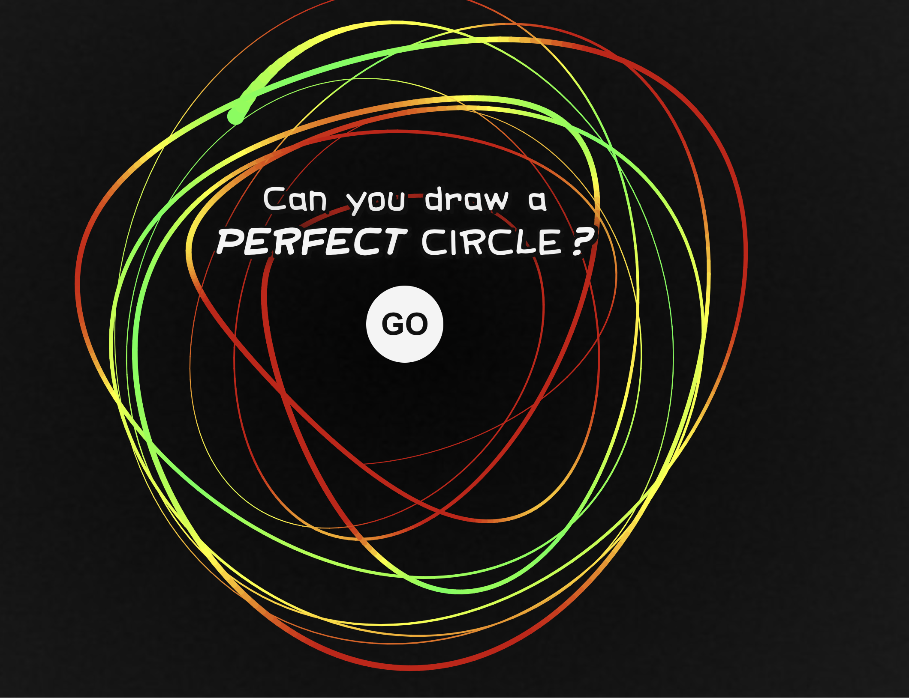

# Overview

* **Webbasiertes Spiel**
* **Kernkonzept:** Sinus zeichnen und einen Score erhalten, der angibt, wie akkurat der Sinus gezeichnet wurde.
* **Ablauf:** Der Sinus soll freihand an einer beliebigen Stelle auf dem Bildschirm gemalt werden können. Anschließend wird der am besten passende Sinus angelegt, von dem aus die Fehlerberechnung erfolgt.
* **Ergebnis:** Nach einem Versuch wird der Score ermittelt und als Prozentwert angegeben (wie nah die Zeichnung am echten Sinus liegt).

---

# Project Management

Das Spiel wird im Rahmen einer Software-Engineering-Vorlesung entwickelt; daher liegt der Fokus stark auf dem Aspekt des Projektmanagements und nicht auf der reinen Umsetzung.
Es soll sich stets am Software Engineering Guide orientiert werden (dies sind die Vorschriften aus der Vorlesung).

### Konkrete Strukturen, die verwendet werden:
* **V-Modell** als übergeordnetes Management-Modell
* **User Stories** auf GitHub
* **Kanban-Board** im Projekt auf GitHub

---

# Implementation / Tech-Stack

* **Hosting:** GitHub Pages
* **Frontend / Logik:**
  * TypeScript
  * HTML
  * CSS

---

# Konkrete Umsetzung

### 1. Startbildschirm & Idle-Animation
* Der Default-Screen zeigt eine Idle-Animation von mehrere freihandgezeichneten Sinuskurven. (ähnlich wie bei Neal.fun: Perfect Circle):  
  
* Diese Animation stoppt nach einer bestimmten Zeit oder sobald der Nutzer einen Versuch startet.

### 2. Zeichenmechanik & Regeln
* **Start- und Endpunkt:** Man soll den Sinus an einer beliebigen Stelle anfangen und aufhören können.
* **Mindestlänge:** Für eine Wertung (Score) muss mindestens eine gesamte Periode gezeichnet werden.
* **Ausrichtung:** Der Sinus soll auch schräg gezeichnet werden können; das System versucht dann, einen passenden Sinus über das schräge Bild zu legen.
* **Visuelles Feedback:** Die gezeichneten Linien sollten einen Farbverlauf von Grün zu Rot aufweisen – abhängig davon, wie nah man am perfekten Sinus liegt.
* **Abschluss:** Der Versuch ist beendet (fertig), sobald man aufhört zu zeichnen.
* **Neustart:** Ein neuer Versuch soll gestartet werden, wenn der Nutzer erneut anfängt zu zeichnen.

### 3. Auswertung & Statistiken
* Nach einem Spiel werden der aktuelle Score und der Highscore der Session angezeigt.
* Es soll zudem eine Option geben, sich die Statistiken der Session ausgeben zu lassen (ähnlich wie bei einem Spotify Wrapped - also score, highscore der aktuellen session, anzahl der versuche, durchschnittlicher score, etc).
* Highscore wird in cookie Gespeichert

### 4. Score-Berechnung & A/B/n-Testing
* Es existiert eine modulare Schnittstelle (`IScoreStrategy`) nach dem GoF Strategy Pattern zur Score-Berechnung:
  * **Übergabewerte:**
    * Die Messpunkte der Zeichnung (hochfrequente Koordinaten).
    * Die gefitteten Parameter der Funktion $a \cdot \sin(\omega x + b) + c$ und die Ausrichtung $\theta$.
  * **A/B/n-Testing:** Es werden 5 mathematisch distinkte Strategien implementiert und empirisch verglichen:
    1. **Strategie 1 (RMSE / $L_2$):** Quadratische orthogonale Punkt-zu-Kurve-Abweichung (straft einzelne grobe Ausreißer stark ab).
    2. **Strategie 2 (Integral-Fläche / $L_1$):** Mittlere absolute Flächenabweichung (MAE) zwischen Zeichnung und Sinuskurve (fehlertoleranter gegenüber Einzelwacklern).
    3. **Strategie 3 (Harmonische Symmetrie & Isochronismus):** Skaleninvariante Schwingungsbewertung aus Berg/Tal-Amplitudenbalance, Halbperioden-Gleichförmigkeit und $R^2$.
    4. **Strategie 4 (Tangenten- & Krümmungs-Ausrichtung):** Kosinus-Ähnlichkeit der Geschwindigkeits- und Tangentenvektoren ($\dot{y}$ Richtungsfluss und Glattheit).
    5. **Strategie 5 (Chebyshev / $L_\infty$):** Strikter Worst-Case-Toleranz-Modus (basiert auf dem maximalen Einzelfehler).
  * **Telemetrie:** Zuweisung und Scores werden im Session Store erfasst, um die Strategien im A/B/n-Verfahren empirisch zu bewerten.
